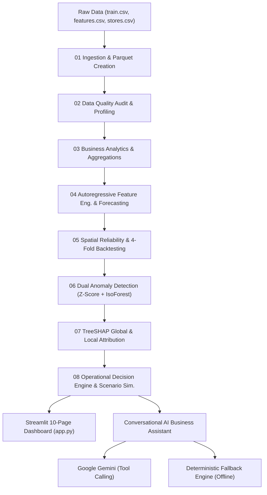

# RetailIQ AI V2

**An Explainable Retail Sales Forecasting, Decision Intelligence & AI Assistant Platform**

[](file:///tests/)
[](file:///pyproject.toml)
[](file:///app.py)
[](file:///reports/sales_forecasting/)
[](file:///reports/explainable_ai/)
[](file:///src/retailiq/assistant/)

---

## 1. Executive Summary

**RetailIQ AI V2** is a portfolio- and research-grade enterprise retail intelligence platform built from the ground up on historical Walmart weekly sales records across 45 stores and 81 departments. It bridges the gap between raw data engineering, time-series forecasting, spatial reliability diagnostics, dual-detector anomaly auditing, cooperative game-theory interpretability (TreeSHAP), simulated operational strategy, and an evidence-grounded conversational AI assistant powered by Google Gemini with deterministic offline failover.

The platform includes:
- **Reproducible Pipelines:** 8 automated analytical pipeline stages executed in strict sequence via `python scripts/run_all_pipelines.py` (all outputs regenerated in ~135 seconds).
- **Enterprise Dashboard:** A 10-page dark Slate-950/900 Streamlit web application (`app.py`) built with Material Symbols, Inter typography, responsive card layouts, and 15+ custom Plotly visualizations.
- **Conversational AI Business Assistant:** Dual-route intelligence supporting freely written natural language queries, multi-turn entity continuity, pairwise store/model comparisons, chart generation, and data boundary guardrails.
- **Automated Verification:** 167 automated pytest unit, integration, benchmark, and smoke tests (100% pass rate).

---

## 2. Core Capabilities & Implemented Phases (01–13)

| # | Pipeline Stage / Module | Technical Methodology | Key Verified Outcome |
|:---:|:---|:---|:---|
| **01** | **Data Engineering & Lineage** | Schema validation, duplicate checks, join integrity, Parquet storage | 421,570 records preserved (100.0%); 0 duplicate records; 0 foreign key dropouts |
| **02** | **Data Quality & Reconciliation** | Missingness reconciliation, statistical profiling, customer returns audit | 100% complete historical sales period; 1,285 customer returns (-$88.2K) audited |
| **03** | **Business Analytics** | Hierarchical store-week rollups, Pareto shares, holiday lift analysis | $6.74B historical revenue; Store 20 #1 ($301.4M); Thanksgiving lift: +41.34% |
| **04** | **Sales Forecasting** | 18 autoregressive/cyclical features, chronological train/val/test splits | Champion XGBoost: **3.83% WAPE** ($39.8K MAE); Ridge: **RMSE $58.7K**, $R^2=0.9879$ |
| **05** | **Forecast Reliability** | Spatial error spread across 45 stores, 4-fold expanding-window backtests | 77.8% store win rate vs Naive; error spread from 2.06% (Store 37) to 10.59% (Store 14) |
| **06** | **Anomaly Detection** | Residual Z-score (|Z|>3.0) + multivariate Isolation Forest consensus | 23 prioritized review targets (2.3%); 14 unanimous flags; 99.09% detector agreement |
| **07** | **Explainable AI (TreeSHAP)** | Global feature attributions, local waterfall decomposition, efficiency axiom | Top 2 features explain 72.66% power (lag_52: 45.0%, rolling_mean_4: 27.7%); 100% reconstructed |
| **08** | **Operational Strategy** | 4-Quadrant Store Matrix (Volume vs WAPE), Dynamic Buffers & Scenario Simulator | Simulated potential savings: $12.3M at 4.5% holding cost (interactive 1%–12% curve) |
| **09** | **Enterprise Dashboard** | Multi-page Streamlit application (`app.py`), Slate design tokens, Plotly charts | Sub-second cold start; 10 operational pages; 100% responsive dark mode |
| **10** | **AI Business Assistant** | Dual-route: Gemini (`gemini-2.0-flash`) tool calling + deterministic fallback | 13 typed Python tools; multi-turn entity context; 100% benchmark score (40/40) |
| **11** | **Independent Scientific Audit** | Adversarial validation of claims, code contracts, and metric calculations | Discovered 6 empirical issues; established rolling 1-step operational horizon |
| **12** | **Scientific Corrections** | Formal resolution of all 6 audit findings across codebase, UI, and reports | Resolved all 6 issues; 161 automated passing tests; corrected attribution math |
| **13** | **Deployment Readiness** | Secret protection, security audit, CORS/XSRF configuration, 6-dim AI evaluation | 167 automated passing tests; zero secrets exposed; cloud deployment ready |

---

## 3. Scientific Findings & Forecasting Leaderboard

### Operational Forecasting Leaderboard (June–October 2012 Held-Out Test Split, $N = 990$)

Evaluation protocol: **Rolling 1-week-ahead operational forecast ($t+1$) with observed historical sales updated at $t-1$**.

| Rank | Model Architecture | WAPE (%) | MAE ($) | RMSE ($) | $R^2$ | Operational Specialty |
|:---:|:---|:---:|:---:|:---:|:---:|:---|
| **1** | **XGBoost Regressor (Champion)** | **3.83%** | **$39,837.61** | **$60,391.89** | **0.9872** | **Best for Volume Replenishment:** Minimizes absolute dollar deviations (-22.3% vs Naive). |
| 2 | Ridge Linear Regressor | 3.91% | $40,642.00 | **$58,728.02** | **0.9879** | **Best for Tail Outlier Protection:** L2 loss penalizes large errors, achieving lowest RMSE. |
| 3 | Random Forest Regressor | 4.00% | $41,641.25 | $64,746.19 | 0.9853 | Non-linear ensemble baseline. |
| 4 | Previous-Week Naive Baseline | 4.93% | $51,307.24 | $77,389.89 | 0.9790 | Naive operational persistence heuristic ($y_t = y_{t-1}$). |
| 5 | Seasonal Naive (52-Week) Baseline | 5.12% | $53,266.11 | $82,732.61 | 0.9760 | Annual seasonality persistence heuristic ($y_t = y_{t-52}$). |

### Objective-Dependent Model Trade-Off
- **XGBoost:** Preferred for store inventory allocation and weekly replenishment orders because it minimizes mean absolute error ($39.8K) across 95% of typical trading weeks.
- **Ridge Regression:** Preferred for financial liquidity reserves and cash stress-testing because its quadratic L2 loss strongly suppresses catastrophic outlier mistakes (lowest RMSE: $58.7K).

---

## 4. Explainable AI & TreeSHAP Attributions

Global feature importances computed via TreeSHAP on held-out test predictions establish empirical decision weights:

| Rank | Feature Name | Mean Absolute SHAP ($) | Relative Impact (%) | Operational Meaning |
|:---:|:---|:---:|:---:|:---|
| **1** | `lag_52` | $228,670.69 | **45.01%** | Same week prior year ($t-52$). Anchors annual seasonality. |
| **2** | `rolling_mean_4` | $140,471.14 | **27.65%** | Trailing 4-week moving average. Captures recent monthly momentum. |
| **3** | `rolling_mean_8` | $53,905.49 | **10.61%** | Trailing 8-week moving average. Smooths medium-term trend. |
| **4** | `lag_4` | $26,446.84 | **5.21%** | Sales from 4 weeks prior ($t-4$). |
| **5** | `lag_1` | $11,216.56 | **2.21%** | Immediate preceding week sales ($t-1$). Weekly baseline momentum. |
| **6** | `lag_2` | $10,532.44 | **2.07%** | Intermediate autoregressive lag ($t-2$). |
| 7–20| Macro & Store Metadata | <$9,000.00 each | <2.0% each | Unemployment (1.62%), CPI (0.46%), Size (0.50%), Fuel Price (0.54%). |

> **Key Scientific Takeaway:** Together, **`lag_52` (45.01%) and `rolling_mean_4` (27.65%) account for 72.66% (~72.7%) of total model decision weight**. Macroeconomic indicators serve purely as fine-tuning adjustments.

---

## 5. Technology Stack & Architecture



- **Languages & Frameworks:** Python 3.12, Streamlit 1.30+, Node.js (npm scripts)
- **Data Engineering:** Pandas 2.1+, NumPy 1.26+, PyArrow 14.0+
- **Machine Learning:** Scikit-learn 1.4+, XGBoost 2.0+, Joblib
- **Interpretability:** SHAP 0.43+ (TreeExplainer)
- **Visualization:** Plotly Express & Plotly Graph Objects 5.18+
- **Generative AI:** Google Gemini API (`google-genai` SDK)
- **Testing & Quality Assurance:** Pytest 8.0+ (167 passing tests)

---

## 6. Quick Start & Execution Guide

### Instant Start via Node / npm (Recommended)
Launch the application immediately without manually managing shell paths:

```bash
# Start Streamlit application on http://localhost:8501
npm run dev

# Run automated 167-test pytest suite
npm test
```

### Python CLI Setup

```bash
# 1. Clone repository and navigate to root
git clone <repo-url>
cd retailiq-ai-v2

# 2. Activate virtual environment
source .venv/Scripts/activate  # Windows Git Bash
# or .venv\Scripts\activate   # Windows CMD/PowerShell

# 3. Verify dependencies
pip install -r requirements.txt

# 4. Optional: Configure Gemini API Key in .env (Deterministic fallback works 100% offline without it)
cp .env.example .env
# Edit .env and set GEMINI_API_KEY="your-api-key"
```

### Running the End-to-End Pipeline
To regenerate all 44 reports, trained models, Parquet tables, and TreeSHAP attributions from source CSVs:

```bash
python scripts/run_all_pipelines.py
```

### Running the Test Suite
```bash
# Run complete 167-test suite
pytest -q

# Run targeted AI evaluation suite
python scripts/run_independent_ai_evaluation.py
```

### Launching the Dashboard
```bash
python -m streamlit run app.py
```

---

## 7. AI Business Assistant & Supported Multi-Turn Dialogue

The RetailIQ Business Assistant features dual-route intelligence:
1. **Live Generative Mode (Online):** Powered by Google Gemini with typed function calling across 13 native analytical tools.
2. **Deterministic Fallback Mode (Offline):** Instant (<0.05s) rule-based dispatcher with conversational context tracking, multi-turn entity continuity, and Plotly visualization generation.

### Example Multi-Turn Conversation Supported:
- **User:** *"Which store had the highest historical sales?"*  
  **Assistant:** Identifies **Store 20** ($301,397,792.46 total revenue across 143 weeks, Type A Supercenter).
- **User:** *"Compare it with Store 14."*  
  **Assistant:** Resolves "it" to Store 20 and executes a pairwise comparison with Store 14 ($288,999,911.34).
- **User:** *"What is their sales difference?"*  
  **Assistant:** Calculates exact delta: Store 20 generated **+$12,397,881.12** (+4.29%) more sales overall (+**$86,698.47/wk**).
- **User:** *"Show the comparison as a chart."*  
  **Assistant:** Generates an interactive Plotly bar chart comparing Store 20 vs Store 14 side-by-side.
- **User:** *"Is the difference necessarily good?"*  
  **Assistant:** Delivers operational analysis: Store 20 has steady foot traffic and low forecast error (5.01% WAPE), while Store 14 is the network's most volatile store (10.59% WAPE) requiring a large +18% safety buffer.
- **User:** *"Which forecasting model has the lowest RMSE?"*  
  **Assistant:** Identifies **Ridge Linear Regression** ($58,728.02 RMSE, $R^2=0.9879$).
- **User:** *"Why does that differ from the model with the lowest MAE?"*  
  **Assistant:** Explains L2 squared loss geometry (Ridge penalizing extreme tail surprises) vs non-linear decision trees (XGBoost minimizing absolute dollar volume error).
- **User:** *"Can I trust next month's forecast?"*  
  **Assistant:** Explains that the 3.83% WAPE benchmark measures a **rolling 1-week-ahead operational forecast ($t+1$)**, warning that an unassisted 4-week forecast will suffer autoregressive error compounding without weekly updates.
- **User:** *"What happens if I ask about a store that does not exist?"*  
  **Assistant:** Explains the `STORE_RANGE 1..45` input validation guardrail.
- **User:** *"What was customer foot traffic in Store 20?"*  
  **Assistant:** Acknowledges data limitations: foot traffic is not tracked in the dataset.

---

## 8. Research Integrity, Limitations & Production Disclaimers

To maintain strict scientific defense standards, RetailIQ AI V2 distinguishes empirical measurements from operational hypotheses:

1. **Simulated vs. Measured Financial ROI:**  
   The $12.3M annual inventory holding cost optimization is a **scenario estimate** computed using standard supply chain heuristics ($1.282 \times \text{MAE}$ buffer, $70\%$ unit cost, $4.5\%$ annual holding cost delta). It has not been verified on enterprise ledgers via live A/B store trials. Use the interactive Scenario Simulator in Page 08 to explore custom holding costs (1% to 12%).
2. **Forecast Horizon Semantic Distinction:**  
   The reported 3.83% WAPE reflects a **rolling 1-step-ahead weekly operational evaluation**. It represents weekly store replenishment ordering where register actuals from week $t-1$ are available. It does **not** represent a static 6-month recursive forecast.
3. **Observational vs. Causal Explainability:**  
   TreeSHAP attributions quantify predictive statistical influence within the trained decision tree model. They do not prove counterfactual causality (e.g. cutting promotional markdowns will not automatically generate the SHAP-indicated revenue change without controlled causal experiments).
4. **Data Scope:**  
   The historical Walmart dataset contains gross departmental sales and regional macro indices. It does not contain customer foot traffic, basket size, net profit margins, store addresses, or employee turnover data.

---

## 9. License & Scholarly Citation

Academic research and engineering portfolio project — not licensed for commercial store management.

```bibtex
@misc{retailiq_ai_v2_2026,
  author = {RetailIQ AI Research Team},
  title = {RetailIQ AI V2: Explainable Retail Sales Forecasting & Decision Intelligence Platform},
  year = {2026},
  publisher = {GitHub},
  howpublished = {\url{https://github.com/retailiq-ai-v2}}
}
```
